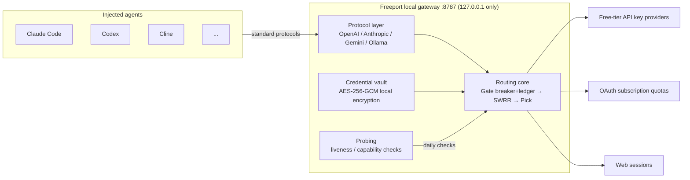

<div align="center">

# ⚓ Freeport

**Local LLM quota aggregation gateway — turn scattered free tiers into one stable local API**

Discover available providers/models → unify OpenAI / Anthropic / Gemini / Ollama protocols → one-click injection into your installed AI agents

[](https://github.com/HanoCode/Free-LLM-plus/releases)
[](https://github.com/HanoCode/Free-LLM-plus/actions/workflows/ci.yml)
[](https://github.com/HanoCode/Free-LLM-plus/releases)
[](https://v2.tauri.app/)

[简体中文](README.md) | English

</div>

---

## What is this

"Free tier" model quotas across providers are fragmented, rate-limited, and speak different protocols. Freeport runs a resident gateway on your machine:

1. **Discover** — which providers you hold credentials for (API key / OAuth / web session) have free tiers that *actually* work right now;
2. **Aggregate** — expose them all as the four standard protocols on `http://127.0.0.1:8787`;
3. **Route** — pick credentials by health × headroom × weight; on 429, switch accounts automatically with category-based exponential cooldown;
4. **Inject** — one click writes the gateway into Claude Code / Codex / Cline and other agents' configs, fully revertible.

> It is a **local reverse proxy + capability prober + config injector**, not a chat client.

## Key Features

| | |
|---|---|
| 🔌 **Four unified protocols** | OpenAI `/v1/chat/completions`, `/v1/responses`, Anthropic `/v1/messages`, Gemini `/v1beta`, Ollama `/api/*` |
| 🧠 **Smart routing** | Three-layer routing: Gate (circuit breaker + four-window quota ledger) → Order (SWRR weighting) → Pick (most headroom + Thompson exploration); session affinity supported |
| 🔄 **429 triage** | Daily quotas rescheduled by retry time, minute-level rate limits back off 90s, no-free-tier providers removed for 24h — cooldown duration follows the failure cause |
| 🛠 **One-click injection** | 20 built-in agent adapters (Claude Code, Codex, Cursor, Cline, Aider, Zed…); only touches nodes it wrote, fully revertible |
| 🔍 **MCP observability** | `freeport --mcp` starts a read-only MCP server, letting agents answer "why did it fail / what can I still use" |
| 📦 **Dual form** | One kernel, two hosts: desktop app (tray-resident) + headless `freeport` daemon (Docker / NAS / systemd) |
| 🔐 **Credentials never leave the machine** | AES-256-GCM encrypted storage (key file 0600), zero telemetry; gateway binds `127.0.0.1` only |
| 🍃 **Free edition is complete** | Gateway, routing, injection, MCP — no feature locks; Pro only sells catalog/intel freshness |

## Quick Start

### Download & install

Grab the installer for your platform from [Releases](https://github.com/HanoCode/Free-LLM-plus/releases):

| Platform | File | Notes |
|---|---|---|
| macOS (Apple Silicon) | `Freeport_*_aarch64.dmg` | Drag into Applications; unsigned build: first launch needs "System Settings → Privacy & Security → Open Anyway" |
| macOS (Intel) | `Freeport_*_x64.dmg` | Same as above |
| Windows x64 | `Freeport_*_x64-setup.exe` | Unsigned build triggers SmartScreen; choose "More info → Run anyway" |

Every artifact ships with a `.sha256` checksum.

### Three steps

```bash
# 1. Start the gateway (desktop app works out of the box; headless mode below)
freeport --port 8787

# 2. Add credentials you legitimately own (API key / OAuth / web session)
#    via the UI, or directly at startup:
freeport --add openrouter=sk-or-... --add gemini=AIza...

# 3. Verify the gateway is up
curl http://127.0.0.1:8787/v1/models
```

Then point any agent at it, or click "Inject" for installed agents in the desktop app:

```bash
export OPENAI_BASE_URL=http://127.0.0.1:8787/v1
```

### Docker deployment

```bash
cp .env.example .env    # fill in FREEPORT_ADD=id=key,id=key
docker compose up -d
docker compose logs -f  # look for FREEPORT_READY port=8787
```

The image ships only the headless daemon; all data lives in the `/data` volume (backing up the volume = backing up all credentials). See [docs/DEPLOY.md](docs/DEPLOY.md) for details.

## Supported Agents

Claude Code · Claude Code (VS Code) · Codex · Cursor · Cline · Roo Code · OpenCode · Continue · VS Code Chat · JetBrains AI · Gemini CLI · Zed · Aider · Crush · Goose · Kilo · Qwen Code · iFlow · Claude Desktop · WorkBuddy

> A config-driven plugin framework: the desktop app detects installed agents and shows per-agent status; inject and rollback are both one click.

## Architecture



**Failure is the norm, and the routing core is designed around it**: failures are scoped to key / model / platform, cooldown = category baseline × 2^(hits−1), and the ledger only ever tightens. Deep dives:

| Doc | Contents |
|---|---|
| [docs/ARCHITECTURE.md](docs/ARCHITECTURE.md) | Full architecture design (routing / quotas / discovery / injection / MCP) |
| [docs/ADR-001-runtime.md](docs/ADR-001-runtime.md) | Why Tauri 2 + Rust, why the gateway is a lib |
| [docs/DEPLOY.md](docs/DEPLOY.md) | Headless deployment: Docker / NAS / systemd |
| [docs/RELEASE.md](docs/RELEASE.md) | Signing, notarization and release handbook |
| [docs/EULA.md](docs/EULA.md) | License terms |

## Build from source

```bash
# Prerequisites: Node 22+, Rust stable (Xcode CLT on macOS, MSVC on Windows)
git clone https://github.com/HanoCode/Free-LLM-plus.git
cd Free-LLM-plus/app

npm ci
npm run dev        # dev mode (Tauri hot reload)
npm run build      # produce desktop installers
npm run test       # cargo test --workspace
```

Build the headless daemon separately:

```bash
cargo build --release -p freeport-daemon
```

## Design boundaries (red lines)

- **No** account registration on your behalf, no account sharing, no paywall circumvention, no device fingerprint spoofing;
- **No** reading the system browser's cookie store (web sessions can only be pasted in by you);
- OAuth uses public client + PKCE only; all credentials are locally encrypted; zero telemetry;
- "Free" means price 0 + catalog flag, never reverse-engineered subscriptions repackaged as free quota;
- No local Ollama fallback — when quota runs out, you get an honest 429 with an ETA.

## License

This project is **proprietary software**, copyright © HanoCode. Grant of use and restrictions: see [docs/EULA.md](docs/EULA.md).

The free edition is fully functional; the Pro subscription only adds catalog/intel freshness — see [docs/PRO-DESIGN.md](docs/PRO-DESIGN.md).

---

<div align="center">

Collecting free tiers too? Give it a try and share feedback → [Issues](https://github.com/HanoCode/Free-LLM-plus/issues)

</div>
