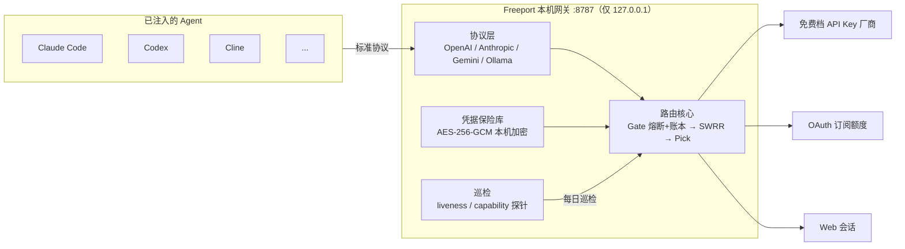

<div align="center">

# ⚓ Freeport · 自由港

**本机大模型额度聚合网关 —— 把散落的免费额度，变成一个稳定的本地 API**

自动发现可用厂商/模型 → 统一 OpenAI / Anthropic / Gemini / Ollama 协议 → 一键注入你已安装的 AI Agent

[](https://github.com/HanoCode/Free-LLM-plus/releases)
[](https://github.com/HanoCode/Free-LLM-plus/actions/workflows/ci.yml)
[](https://github.com/HanoCode/Free-LLM-plus/releases)
[](https://v2.tauri.app/)

</div>

---

## 这是什么

各家「免费档」的模型额度零散、易限流、协议各不相同。Freeport 在你本机跑一个常驻网关：

1. **发现** —— 找出你有凭据（API Key / OAuth / Web 会话）的厂商里哪些免费档现在真的能用；
2. **聚合** —— 把它们统一暴露成 `http://127.0.0.1:8787` 上的四套标准协议；
3. **路由** —— 按「健康 × 余量 × 权重」自动挑凭据，429 了自动换号、按类别指数冷却；
4. **注入** —— 一键把网关写进 Claude Code / Codex / Cline 等 Agent 的配置，可回滚。

> 它是**本地反向代理 + 能力探测 + 配置注入器**，不是聊天客户端。

## 核心特性

| | |
|---|---|
| 🔌 **四协议统一** | OpenAI `/v1/chat/completions`、`/v1/responses`、Anthropic `/v1/messages`、Gemini `/v1beta`、Ollama `/api/*` |
| 🧠 **智能路由** | 三层路由：Gate（熔断 + 四窗口配额账本）→ Order（SWRR 加权）→ Pick（余量最多 + Thompson 探索）；支持会话粘性 |
| 🔄 **429 三分法** | 日额度按重试时间排、分钟限流 90 秒退避、无免费档 24h 移出——冷却时长跟失败原因走 |
| 🛠 **一键注入** | 内置 20 个 Agent 适配器（Claude Code、Codex、Cursor、Cline、Aider、Zed…），只改自己写入的节点，可完整回滚 |
| 🔍 **MCP 可观测** | `freeport --mcp` 起一个只读 MCP server，让 Agent 自己回答「为什么失败 / 现在还能用什么」 |
| 📦 **双形态** | 同一内核两种宿主：桌面 App（托盘常驻）+ `freeport` 无头守护进程（Docker / NAS / systemd） |
| 🔐 **凭据不出本机** | AES-256-GCM 加密存储（密钥文件 0600），无遥测；网关只绑 `127.0.0.1` |
| 🍃 **免费版功能完整** | 网关、路由、注入、MCP 无任何功能锁；Pro 只卖目录与情报的时效性 |

## 快速开始

### 下载安装

从 [Releases](https://github.com/HanoCode/Free-LLM-plus/releases) 下载对应平台的安装包：

| 平台 | 文件 | 说明 |
|---|---|---|
| macOS (Apple Silicon) | `Freeport_*_aarch64.dmg` | 拖入 Applications；未签名包首次打开需「系统设置 → 隐私与安全性 → 仍要打开」 |
| macOS (Intel) | `Freeport_*_x64.dmg` | 同上 |
| Windows x64 | `Freeport_*_x64-setup.exe` | 未签名包会弹 SmartScreen，选「更多信息 → 仍要运行」 |

每个产物附 `.sha256` 校验和。

### 三步用起来

```bash
# 1. 启动网关（桌面版开箱即用；无头模式如下）
freeport --port 8787

# 2. 在界面或配置里填入你合法持有的凭据（API Key / OAuth / Web 会话）
#    也可启动时直接注入：
freeport --add openrouter=sk-or-... --add gemini=AIza...

# 3. 验证网关就绪
curl http://127.0.0.1:8787/v1/models
```

然后把任意 Agent 指向它，或在桌面版里对已安装的 Agent 点「注入」：

```bash
export OPENAI_BASE_URL=http://127.0.0.1:8787/v1
```

### Docker 部署

```bash
cp .env.example .env    # 填 FREEPORT_ADD=id=key,id=key
docker compose up -d
docker compose logs -f  # 看到 FREEPORT_READY port=8787 即就绪
```

镜像只含无头守护进程，数据都在 `/data` 卷里（备份卷 = 备份全部凭据）。详见 [docs/DEPLOY.md](docs/DEPLOY.md)。

## 支持注入的 Agent

Claude Code · Claude Code (VS Code) · Codex · Cursor · Cline · Roo Code · OpenCode · Continue · VS Code Chat · JetBrains AI · Gemini CLI · Zed · Aider · Crush · Goose · Kilo · Qwen Code · iFlow · Claude Desktop · WorkBuddy

> 配置驱动的插件框架，桌面版检测到已安装的 Agent 后逐个显示状态，注入/回滚均可视化操作。

## 架构一览



**失败是常态，路由核心围绕它设计**：失败按 key / model / platform 分作用域处理，冷却时长 = 类别基准 × 2^(命中次数-1)，账本只收紧不放松。想深入了解设计取舍：

| 文档 | 内容 |
|---|---|
| [docs/ARCHITECTURE.md](docs/ARCHITECTURE.md) | 完整架构设计（路由/配额/发现/注入/MCP） |
| [docs/ADR-001-runtime.md](docs/ADR-001-runtime.md) | 为什么是 Tauri 2 + Rust，网关为什么做成 lib |
| [docs/DEPLOY.md](docs/DEPLOY.md) | Docker / NAS / systemd 无界面部署 |
| [docs/RELEASE.md](docs/RELEASE.md) | 签名、公证与发版手册 |
| [docs/EULA.md](docs/EULA.md) | 许可协议 |

## 从源码构建

```bash
# 依赖：Node 22+、Rust stable（macOS 需 Xcode CLT，Windows 需 MSVC）
git clone https://github.com/HanoCode/Free-LLM-plus.git
cd Free-LLM-plus/app

npm ci
npm run dev        # 开发模式（Tauri 热重载）
npm run build      # 产出桌面安装包
npm run test       # cargo test --workspace
```

无头守护进程单独构建：

```bash
cargo build --release -p freeport-daemon
```

## 设计边界（红线）

- **不**代注册账号、不共享账号、不绕付费墙、不伪造设备指纹；
- **不**读取系统浏览器的 Cookie 库（Web 会话只能由你手动粘贴）；
- OAuth 只用 public client + PKCE，凭据全部本机加密存储，无遥测；
- 「免费」判定只看价格 0 + 目录标注，绝不把逆向订阅包装成免费额度；
- 不接本地 Ollama 当兜底——额度耗尽就如实报 429 和预计恢复时间。

## 许可证

本项目为**专有软件**（proprietary），版权所有 © HanoCode。个人使用授权与限制条款见 [docs/EULA.md](docs/EULA.md)。

免费版功能完整；Pro 订阅仅提供目录/情报的实时性增强，详见 [docs/PRO-DESIGN.md](docs/PRO-DESIGN.md)。

---

<div align="center">

如果你也在攒各种免费额度，欢迎试试并提出反馈 → [Issues](https://github.com/HanoCode/Free-LLM-plus/issues)

</div>
