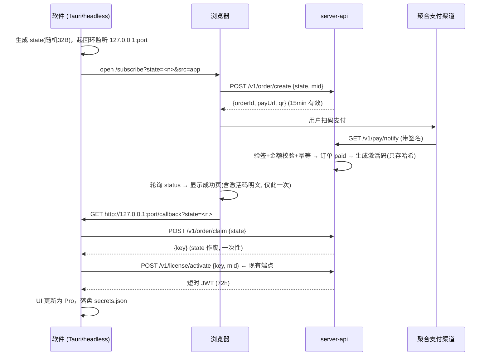

# 立即订阅：从软件内一键到支付成功的授权闭环

> 状态：**已实现**（v3，与代码同步）。实现落点见 §6。
> 已确认的前提（v4，2026-10-25 改版）：**支付渠道=Buy Me a Coffee（PWYW 任意金额）**；**定价=随意付（无固定价）**；**席位=3 台**（订阅页与弹窗标注）；**回跳=轮询主路径**（BMAC 无回跳，回环回调仅作页面在开时的加速）；**退款自动吊销激活码**；**v1 不做发票（已接受）**。
> 改版原因：收款主体有海外账户（BMAC 可提现），且希望以「任意金额支持」替代固定定价。JianPay 链路已整体移除（git 历史可查）。
> **v5（2026-10-25 终版）：产品改为完全免费。** `pro::FREE_FOR_ALL = true`，所有 Pro 功能对所有人开放；本设计中的订阅/支付/发码链路**代码保留但休眠**（server-api 订阅端点无人调用、客户端订阅 UI 无入口、license 激活机制照常工作）。恢复收费 = 把 `FREE_FOR_ALL` 翻回 `false` + 重新配置渠道 env，其余零改动。
> 锚点：`server-api` 已有 `activate/refresh/deactivate` 全链路，本设计**不另起授权体系**，只加「下单→支付→发码」前置段。
> **v6（2026-10-25，v0.1 发布清理）：server-api 已整体移除。** 产品首发即全免费，订阅/激活服务器没有存在的必要；客户端侧的激活机制（`freeport-license` + `gateway/license.rs`）保留但休眠，`FREE_FOR_ALL` 分支见 `pro.rs`。恢复收费 = 按**本设计 + git 历史**重建服务器（v0.1 前的完整实现在历史提交里），再把 `FREE_FOR_ALL` 翻回 `false`。

### 实现落点（v3 与代码同步）

| 模块 | 文件 |
|---|---|
| 渠道抽象 + 简支付/Mock | `server-api/src/pay.rs`（enum 而非 trait：两个实现用 enum 免 async-trait 依赖，新渠道 match 穷尽） |
| 订单存储 | `server-api/src/store.rs`（`orders` 表，状态机 `created→issued/expired`，读时惰性过期） |
| 端点 | `server-api/src/http.rs`（`/subscribe`、`/v1/order/{create,status,claim}`、`/v1/pay/notify/:provider`、`/v1/license/{devices,unbind}`、admin `/admin/api/orders`） |
| 订阅页 | `server-api/src/subscribe.html`（单文件：下单/二维码/轮询/领码/回跳） |
| 客户端订阅流 | `app/crates/freeport-gateway/src/license.rs`（`subscribe_start/wait/cancel`、`license_devices/unbind`） |
| DTO | `app/crates/freeport-core/src/dto.rs`（`GwSubscribeStart/State`、`GwDevice(s)`） |
| Tauri 命令 | `app/src-tauri/src/lib.rs`（`gw_subscribe_*`、`gw_license_devices/unbind`） |
| 前端 | `bridge.ts`/`ipc.ts`/`gateway.ts` + `License.tsx`（waiting 视图 + 设备管理区） |

与 v2 稿的两处实现偏差：① `/v1/order/status` 用 POST（与其它端点一致，客户端 helper 复用）；② 渠道抽象用 enum 不用 trait object（语义不变）。

### BMAC 对接要点（实现依据，https://studio.buymeacoffee.com/webhooks/docs）

- 支付入口=**静态捐赠页**（`FREEPORT_PAY_BMAC_PAGE_URL`），付款人自定金额；服务端不下单、不传金额、无 metadata
- **订单↔支付的唯一纽带是付款邮箱**：软件内挂单时收集邮箱（归一化 trim+lower），webhook 按 `supporter_email` 匹配最早的未支付挂单
- webhook：`donation.created` / `donation.refunded`，签名=HMAC-SHA256(原始 body, signing secret)，`x-signature-sha256` 头（旧版 `x-bmc-signature` 兼容）；payload 信封 `{type, data:{...}}`（旧 `{response:{...}}` 兼容）；金额为元字符串（"4.43"），仅展示不比对
- **验签失败也回 200**：BMAC 连续 10 次投递失败自动停用 webhook，伪造签名无邮箱匹配发不了码，回 200 无害；webhook 丢失兜底=BMAC 后台 supporters 人工对账（REST `GET /v1/supporters` 对账留作后续）
- 幂等：`transaction_id` 全局去重；退款通知幂等（重复 refund 只吊销一次）
- 挂单窗口 7 天（mock 仍 15 分钟）；过期后迟到的付款照常匹配发码（PWYW 无库存占用），完全无挂单的捐赠落 `paid_unmatched` 留痕待人工
- 凭据环境变量：`FREEPORT_PAY_BMAC_PAGE_URL` + `FREEPORT_PAY_BMAC_WEBHOOK_SECRET`；BMAC 后台配置 webhook URL=`{PUBLIC_BASE}/v1/pay/notify/bmac`，事件勾 donation.created/donation.refunded
- 退款（donation.refunded）→ 订单 issued→refunded + 激活码吊销，最迟 72h token 到期后设备失去 Pro 数据面

### 与 v1 稿的两处修订

1. **claim 改为可重复但限流**（原稿「一次性作废」）：手动兜底要求支付成功页能反复查看激活码，且 state 是 256-bit 随机值不可枚举，重复 claim 的前提是持有 state，与 OAuth code 同一信任级别。限流防爆破即可。
2. 渠道演进：虎皮椒 → 简支付（v3）→ **Buy Me a Coffee（v4，现行）**。每次只换 Provider 实现与回调匹配逻辑，订单/激活码/设备全链路不动。

## 0. 对原始思路的修正

| 原始猜测 | 修正 | 理由 |
|---|---|---|
| 订阅页 URL 带机器码 | URL 只带一次性 `state`（随机 32B nonce）；`mid` 在页面 JS 创建订单时随 POST 提交 | 浏览器历史/服务端日志/分享链接里都不该出现任何设备标识；state 走 URL 是 OAuth 惯例，泄露无害 |
| 支付回调成功后自动跳回软件 | 回环回调只送 `state`，**不送激活码**；app 凭 state 调 `/v1/order/claim` 一次性取码 | 明文激活码只在 https 与本机回环各走一次，且服务端控制一次性消费 |
| 后台创建授权码（永久） | 保留，但「永久」= 现有 key 表 `expires_at=NULL, plan=lifetime`；客户端仍拿**短时 JWT**（72h，每 6h refresh） | 复用现有激活/续签/吊销/席位全链路。若支付后直接发永久 token，等于放弃吊销能力 |

## 1. 总体时序



三层降级，任何一层失败都不阻断：

1. **回环回调**（主路径，体验最好）：浏览器跳 `127.0.0.1` 拉起授权完成
2. **轮询兜底**：app 每 5s 调 `GET /v1/order/status?state=`，浏览器被关/回调被拦也能拿到结果（拿到 `paid` 后同样走 claim）
3. **手动兜底**：成功页展示激活码明文，用户复制后走现有「已有激活码」输入框（headless 用户的唯一路径，URL 打印到 stderr）

## 2. 服务端设计（server-api）

### 2.1 新增存储（SQLite，复用现有库）

```sql
CREATE TABLE orders (
  order_id     TEXT PRIMARY KEY,      -- 'ord_' + 随机
  state_hash   TEXT UNIQUE NOT NULL,  -- sha256(state)，库被拖也还原不出 state
  mid          TEXT,                  -- 机器指纹哈希，可空（网页直接买没有 mid）
  amount_cents INTEGER NOT NULL,      -- 建议价（BMAC PWYW 不比对）
  payer_email  TEXT,                  -- 付款邮箱（BMAC 匹配纽带）
  status       TEXT NOT NULL,         -- created → paid → issued → expired
  provider     TEXT,                  -- mock / xunhu / ...
  provider_oid TEXT,                  -- 渠道侧订单号，对账用
  key_hash     TEXT,                  -- 支付成功后生成的激活码
  created_at   INTEGER NOT NULL,
  paid_at      INTEGER,
  expire_at    INTEGER NOT NULL       -- created 后 15 分钟
);
```

激活码仍走现有 key 表（`plan='lifetime'`, `expires_at=NULL`, `seats=1`），只存 `sha256`；配置了 `FREEPORT_KEYS_ENC_KEY` 则明文加密落库供 admin 回看——两套机制都已存在，零改动。

### 2.2 新增端点

| 端点 | 说明 |
|---|---|
| `GET /subscribe` | 静态订阅页（单文件 HTML，同 admin.html 模式） |
| `POST /v1/order/create` | `{state, mid?}` → 建订单 + 调渠道下单 → `{orderId, payUrl, expireAt}`。同 state 重复创建幂等返回 |
| `GET /v1/order/status?state=` | 轮询端点。**限流**（同 IP 1次/s）。只回 `{status}`，不回码 |
| `POST /v1/order/claim` | `{state}` → 校验 paid + 未领取 → 返回激活码明文，state 立即作废（一次性）。**这是明文唯一出口** |
| `POST /v1/pay/notify/:provider` | 渠道异步回调：验签 → 金额比对 → 幂等标记 paid → 生成激活码 |
| `GET /v1/license/devices` | Bearer token → 该激活码的席位占用列表（设备指纹哈希、最近活跃） |
| `POST /v1/license/unbind` | Bearer token + 目标绑定 id → 解绑（复用 deactivate 语义，加自我服务入口） |

### 2.3 渠道抽象（PaymentProvider trait）

```rust
trait PaymentProvider {
    fn id(&self) -> &str;
    async fn create_order(&self, order: &NewOrder) -> Result<PayInfo, String>; // payUrl+qr
    fn verify_notify(&self, req: &NotifyReq) -> Result<VerifiedPay, String>;   // 验签+金额
}
```

- 实现 `MockProvider`（测试桩，仅 `FREEPORT_PAY_MOCK=1` 时注册）+ `BmacProvider`（Buy Me a Coffee）
- BMAC 签名：HMAC-SHA256（原始 body）；**验签失败照常 200**（见对接要点）、重复通知按订单状态幂等、PWYW 无金额闸门

### 2.4 订单状态机

```
created ──(渠道回调 paid)──▶ issued（同事务发码）──▶ claim（可重复、限流）
   │
   └──(挂单窗口未付)──▶ expired（BMAC 迟到付款仍可匹配发码）
issued ──(donation.refunded)──▶ refunded（激活码吊销）
（BMAC 无挂单的捐赠）──▶ paid_unmatched（留痕，admin 人工发码）
```

- `paid → issued` 同一事务内完成，回调重放不会生成第二个码
- 过期订单的 state 允许重新 create（幂等键是 state_hash）
- 对账：admin 页加订单列表（复用 admin.html 扩展），关键字段=渠道单号 vs 本地状态

## 3. 客户端设计（freeport-gateway + Tauri + 前端）

### 3.1 gateway 侧（`license.rs` 扩展）

```
subscribe_start()      生成 state → 起回环 TcpListener（随机端口，复用 freeport-auth::sub 的
                       pick_port 模式）→ 返回订阅页 URL
subscribe_wait()       双路等待：回环回调收到即返回；同时 5s 轮询 status
claim + activate       claim 拿码 → 直接复用现有 activate_license(key) 全链路
```

- 回环端点仅绑 `127.0.0.1`、校验 `state` 参数、收到即关（一次性）
- headless：`--subscribe` 打印 URL 到 stderr，只走轮询+手动路径
- 激活码明文进 `secrets.json`（现有 vault 路径），不落明文日志

### 3.2 Tauri / IPC

- 新命令：`license_subscribe_start` / `license_subscribe_cancel`
- `ipc.ts` 唯一门面加两个方法；bridge 不可用时（浏览器 dev 模式）按钮标「未接入」——红线

### 3.3 UI：授权管理 tab

现有 `License.tsx` 的 LicenseDialog 保留，Settings 里升级为独立「授权管理」分区：

| 区块 | 内容 | 数据源 |
|---|---|---|
| 授权状态 | Free/Pro/宽限/过期 徽标 + 到期时间（永久版显示「永久」） | 现有 `license` state |
| 授权信息 | 授权给(sub)、套餐(lifetime)、席位、激活时间 | 同上 |
| 立即订阅 | 主按钮 → 打开浏览器订阅页，弹窗内显示「等待支付中…」（轮询驱动状态） | subscribe_start |
| 设备管理 | 设备列表（指纹哈希尾 8 位 + 最近活跃 + 本机标记）+ 解绑按钮 | `GET /v1/license/devices` |
| 激活码 | 已激活显示码（尾 4 位明文，点击完整复制）+「已有激活码」手动输入入口 | 本地 secrets |

文案红线沿用：过期只降级不罢工，Pro 卖本机功能，界面写明。

## 4. 安全要点清单

1. `state` 一次性 + 10 分钟有效 + 服务端只存哈希；claim 后立即作废
2. 激活码明文唯一出口是 `claim`（https）与支付成功页（一次性渲染），均限流
3. 渠道回调：验签 + 金额比对 + 幂等，三关全过才 paid
4. 回环回调不做信任锚：真正的授权发生在 app 主动 `activate`，回调被伪造最多触发一次无害的 claim 尝试（没有 state 就拿不到码）
5. 现有限流（activate 防爆破）、token 72h TTL、吊销能力全部不动
6. `mid` 全程只在 POST body 与订单表内，不进 URL、不进日志

## 5. 已确认的决策（2026-10-25，v4 更新）

1. 支付渠道：**Buy Me a Coffee**（PWYW；运营者已有海外提现账户）
2. 定价：**任意金额**（无最低门槛，真 PWYW）；旧定价（¥29/月、¥199/年、¥29.9）全部下线
3. 永久码席位：**3 台**，订阅页与客户端弹窗均标注「含 3 台设备」
4. 退款：**自动吊销**已发激活码（donation.refunded 驱动）
5. v1 不做发票，已接受；订单凭据=支付成功页 + admin 后台
6. 已知取舍：BMAC 仅国际卡/Apple Pay/Google Pay（无微信/支付宝，国内用户转化受限）；综合费率 ~9-10%；用 donation 名义收软件授权属平台 ToS 灰色地带——后续可迁 Merchant of Record（Polar/Lemon Squeezy），Provider 枚举加一个实现即可

## 6. 实现切分（确认后执行）

1. server-api：orders 表 + PaymentProvider trait + Mock + 5 个端点 + subscribe.html
2. 客户端：license.rs 订阅流 + Tauri 命令 + ipc
3. UI：授权管理 tab + LicenseDialog 接「立即订阅」
4. 聚合支付 Provider 接入（渠道确定后）
5. e2e：mock 支付全链路（下单→回调→claim→activate→devices）
